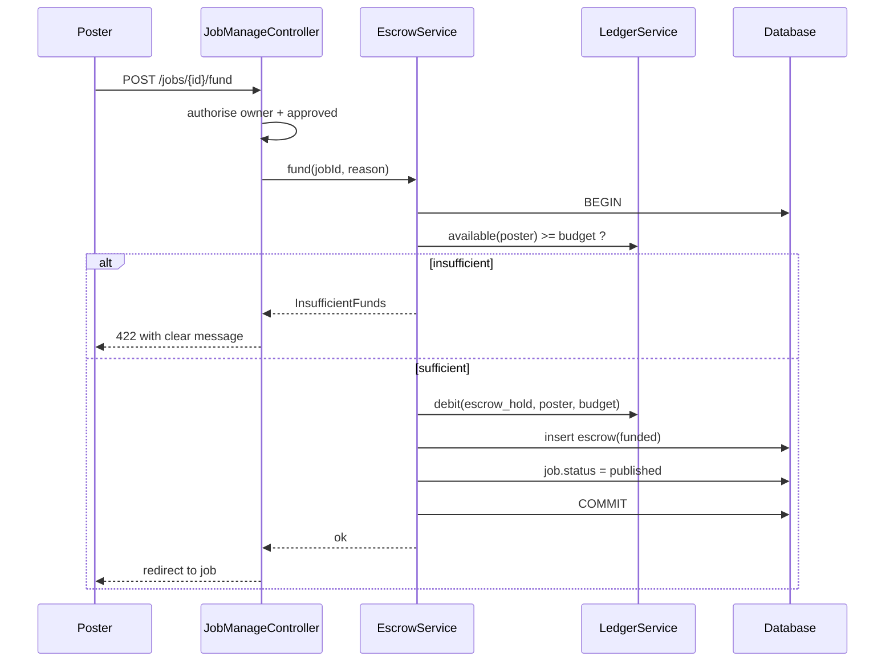
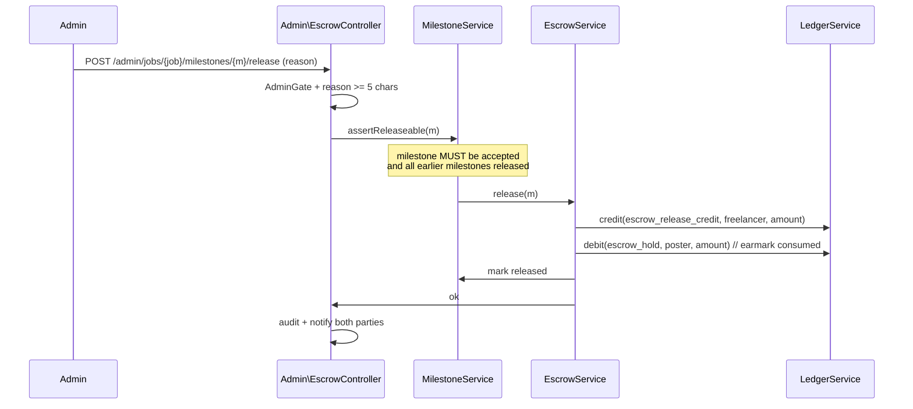
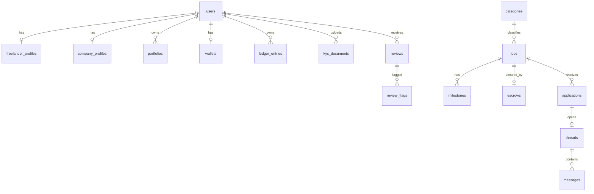

# Design — Trust-Prime

> Answers *how*. Must agree with `requirements.md` (revision 3) and with
> `hosting-capability.md`.

---

## Components

| Component | Responsibility | Depends on |
|---|---|---|
| `AuthController` | register, login, logout, password reset | `User`, rate limiter |
| `AccountGate` (middleware) | blocks gated actions for `pending`/`suspended` users | `User` |
| `AdminGate` (middleware) | requires `admin` role on every admin route | `User` |
| `JobController` (public) | landing list, search, filter, job detail | `Job`, `Category` |
| `JobManageController` (poster) | create/edit own jobs, fund escrow, view applicants | `JobService` |
| `ApplicationController` | apply, list applicants, hire/decline | `ApplicationService` |
| `ThreadController` | per-application messaging, polling | `Thread`, `Message` |
| `MilestoneController` | mark delivery, accept delivery | `MilestoneService` |
| `WalletController` | own balance, ledger view, withdrawal request | `WalletService` |
| `KycController` | upload, view own document | `KycService` |
| `ReviewController` | submit/update review, flag a review | `ReviewService` |
| `ProfileController` | freelancer profile + portfolio CRUD | `FreelancerProfile`, `Portfolio` |
| `Admin\DashboardController` | reporting totals | `ReportService` |
| `Admin\UserController` | approve/reject/suspend/delete accounts | `AccountService` |
| `Admin\JobController` | view/edit/archive any job | `JobService` |
| `Admin\WalletController` | credit/debit any wallet | `LedgerService` |
| `Admin\EscrowController` | release milestone, refund remainder | `EscrowService` |
| `Admin\WithdrawalController` | approve/reject payouts | `WithdrawalService` |
| `Admin\ReviewController` | author/edit/hide/delete reviews | `ReviewService` |
| `Admin\SettingsController` | site name, logo, contact details | `Setting` |
| **`LedgerService`** | **the only writer of money** | `LedgerEntry`, `Escrow`, DB |
| **`EscrowService`** | fund, release, refund — transactional | `LedgerService`, `Escrow` |
| **`WalletService`** | derive balances from ledger | `LedgerEntry` |
| **`MilestoneService`** | ordering rules, state transitions | `Milestone`, `Escrow` |
| **`Money`** (value object) | integer cents, arithmetic, no floats | — |
| **`CurrencyPresenter`** | display conversion from a stored rate | `Setting`, FX cache |
| **`Brand`** (helper) | site name + logo accessor | `Setting` |
| `AuditLogger` | immutable admin action trail | `AuditLog` |
| `NotificationService` | in-app notifications | `Notification` |
| `ReviewService` | review rules, moderation, aggregates | `Review` |

**Rule enforced by structure:** controllers never touch `LedgerEntry`. Only
`LedgerService` writes money, so every movement is auditable in one place.

---

## Data flow

### Funding escrow (poster)



### Milestone release (admin)



### Review submission

```
signed-in user → ReviewController
  → AccountGate (pending/suspended blocked)
  → throttle(review-submit:{user}) and throttle by IP
  → ReviewService.upsert(target_freelancer, reviewer_user, display_name, rating, comment)
      ├─ reject if target == reviewer
      ├─ if existing (target, reviewer_user) → UPDATE
      └─ else INSERT with moderation_state = visible
  → publish immediately to public profile
```

---

## Routes

### Public

| Method | Path | Auth | Role | Purpose |
|---|---|---|---|---|
| GET | `/` | public | — | landing: funded published jobs |
| GET | `/jobs` | public | — | search + filter + sort |
| GET | `/jobs/{job}` | public | — | job detail (404 unless published + funded) |
| GET | `/freelancers` | public | — | freelancer directory |
| GET | `/freelancers/{profile}` | public | — | public profile + reviews |
| GET | `/currency/{code}` | public | — | set display currency (whitelist only) |

### Auth

| Method | Path | Auth | Purpose |
|---|---|---|---|
| GET/POST | `/register` | guest | choose type: freelancer \| poster |
| GET/POST | `/login` | guest | login (throttled) |
| POST | `/logout` | auth | logout |
| GET/POST | `/forgot-password` | guest | request reset |
| GET/POST | `/reset-password/{token}` | guest | one-time reset |

### Freelancer

| Method | Path | Auth | Gate |
|---|---|---|---|
| GET/PUT | `/profile` | auth | — |
| CRUD | `/profile/portfolio` | auth | freelancer |
| GET | `/wallet` | auth | approved |
| POST | `/wallet/deposits` | auth | approved poster — submit deposit + proof |
| GET | `/wallet/deposits` | auth | own deposit requests |
| GET | `/deposits/{deposit}/proof` | auth | owner or admin only |
| POST | `/wallet/withdrawals` | auth | approved + KYC |
| POST | `/kyc` | auth | approved |
| GET | `/kyc/{doc}` | auth | owner or admin |
| POST | `/jobs/{job}/apply` | auth | approved freelancer |
| POST | `/milestones/{m}/deliver` | auth | hired freelancer |

### Poster

| Method | Path | Auth | Gate |
|---|---|---|---|
| GET/PUT | `/company` | auth | poster |
| GET | `/jobs/create` | auth | approved poster |
| POST | `/jobs` | auth | approved poster |
| GET/PUT | `/jobs/{job}/manage` | auth | owner |
| POST | `/jobs/{job}/fund` | auth | owner + approved |
| GET | `/jobs/{job}/applicants` | auth | owner |
| POST | `/applications/{app}/hire` | auth | job owner |
| POST | `/applications/{app}/decline` | auth | job owner |
| POST | `/milestones/{m}/accept` | auth | job owner |

### Messaging

| Method | Path | Auth | Gate |
|---|---|---|---|
| GET | `/threads` | auth | participant only |
| GET | `/threads/{thread}` | auth | participant only |
| POST | `/threads/{thread}/messages` | auth | participant only |
| GET | `/threads/{thread}/poll` | auth | participant only (JSON) |

### Reviews

| Method | Path | Auth | Gate |
|---|---|---|---|
| POST | `/freelancers/{profile}/reviews` | auth | approved, throttled |
| POST | `/reviews/{review}/flag` | auth | any signed-in |

### Admin (all behind `AdminGate`)

| Method | Path | Purpose |
|---|---|---|
| GET | `/admin` | dashboard totals |
| GET | `/admin/users` | list/filter accounts |
| POST | `/admin/users/{user}/approve` \| `/reject` \| `/suspend` \| `/reinstate` \| `/delete` | account lifecycle |
| GET | `/admin/jobs` | all jobs, any status |
| PUT | `/admin/jobs/{job}` | edit any job |
| POST | `/admin/jobs/{job}/archive` | archive (refund path if funded) |
| POST | `/admin/jobs/{job}/milestones/{m}/release` | release one milestone |
| POST | `/admin/jobs/{job}/refund` | refund unreleased remainder |
| GET | `/admin/wallets` | all wallets |
| POST | `/admin/wallets/{user}/credit` \| `/debit` | adjust with reason |
| GET/POST | `/admin/payment-methods` | list and create funding methods |
| PUT | `/admin/payment-methods/{method}` | edit a method |
| POST | `/admin/payment-methods/{method}/enable` \| `/disable` | toggle visibility |
| DELETE | `/admin/payment-methods/{method}` | soft-delete (history preserved) |
| GET | `/admin/deposits` | deposit approval queue |
| POST | `/admin/deposits/{deposit}/approve` | credit the chosen amount |
| POST | `/admin/deposits/{deposit}/reject` | reject with a reason |
| GET | `/admin/deposits/{deposit}/proof` | view submitted proof |
| GET | `/admin/withdrawals` | payout queue |
| POST | `/admin/withdrawals/{w}/paid` \| `/reject` | process payout |
| GET | `/admin/reviews` | review queue (flagged first) |
| POST | `/admin/reviews` | author review, no linked user |
| PUT | `/admin/reviews/{review}` | edit rating/comment |
| POST | `/admin/reviews/{review}/hide` \| `/unhide` \| `/delete` | moderation |
| GET/PUT | `/admin/settings` | site name, logo, contact |
| GET | `/admin/audit` | audit log |
| GET | `/admin/kyc` | KYC queue |

---

## Data model

All money is `BIGINT` **minor units** (cents). All tables `utf8mb4`.

```
users(id, email UNIQUE, password_hash, type ENUM(freelancer,poster,admin),
      status ENUM(pending,approved,rejected,suspended,deleted),
      name, created_at, deleted_at NULL)

freelancer_profiles(id, user_id UNIQUE FK, headline, bio, skills JSON,
                    hourly_rate_cents BIGINT NULL, location, avatar_path)

portfolios(id, user_id FK, title, description, external_url,
           image_path NULL, sort_order, created_at)

company_profiles(id, user_id UNIQUE FK, company_name, about, website, logo_path)

categories(id, name UNIQUE, slug UNIQUE, is_active)

jobs(id, poster_id FK users, category_id FK categories, title, description,
     budget_cents BIGINT, currency CHAR(3) DEFAULT 'USD',   -- USD only
     fx_rate_to_usd DECIMAL(18,8),                          -- rate at creation
     deadline DATE NULL,
     status ENUM(draft,published,in_progress,delivered,completed,refunded,archived),
     hired_freelancer_id FK users NULL, published_at NULL, created_at)

milestones(id, job_id FK, sequence SMALLINT, title, amount_cents BIGINT,
           status ENUM(pending,delivered,accepted,released,refunded),
           delivered_note TEXT NULL, delivered_at NULL, accepted_at NULL,
           released_at NULL,
           UNIQUE(job_id, sequence))

applications(id, job_id FK, freelancer_id FK users, cover_note TEXT,
             proposed_amount_cents BIGINT NULL,
             status ENUM(applied,shortlisted,hired,declined),
             created_at,
             UNIQUE(job_id, freelancer_id))   -- one application per job

threads(id, application_id UNIQUE FK, created_at)

messages(id, thread_id FK, sender_id FK users, body TEXT,
         read_at NULL, created_at,
         INDEX(thread_id, created_at))

notifications(id, user_id FK, type, title, body, url,
              read_at NULL, created_at, INDEX(user_id, read_at))

wallets(id, user_id UNIQUE FK, currency CHAR(3) DEFAULT 'USD')
-- NOTE: deliberately NO balance column. A wallet is an identity for money, not a
-- number. See "Balance derivation" below.

ledger_entries(id, user_id FK, wallet_id FK,
               kind ENUM(deposit_credit,escrow_hold,escrow_release_credit,
                         escrow_refund,withdrawal_hold,withdrawal_paid,
                         withdrawal_rejected_return,admin_credit,admin_debit,
                         job_payment_credit),
               direction ENUM(credit,debit),
               amount_cents BIGINT NOT NULL CHECK(amount_cents > 0),
               currency CHAR(3) DEFAULT 'USD',
               fx_rate_to_usd DECIMAL(18,8) NULL,
               job_id FK NULL, milestone_id FK NULL, withdrawal_id FK NULL,
               deposit_request_id FK NULL,
               reason VARCHAR(255) NOT NULL,     -- min 5 chars, enforced in app
               actor_id FK users NULL,
               created_at,
               INDEX(user_id, created_at), INDEX(job_id))

payment_methods(id, type ENUM(bank_transfer,crypto),
                label VARCHAR(80),                 -- e.g. "GTBank — Trust-Prime"
                bank_name NULL, account_name NULL, account_number NULL,
                routing_detail NULL,
                crypto_asset NULL,                 -- e.g. USDT
                crypto_network NULL,               -- e.g. ERC-20, TRC-20
                crypto_address NULL,
                is_enabled BOOLEAN DEFAULT TRUE,
                sort_order SMALLINT DEFAULT 0,
                created_at, updated_at, deleted_at NULL,
                INDEX(is_enabled, sort_order))

deposit_requests(id, user_id FK, payment_method_id FK NULL,
                 amount_requested_cents BIGINT,
                 credited_amount_cents BIGINT NULL,     -- set by admin on approval
                 currency CHAR(3) DEFAULT 'USD',
                 transfer_reference VARCHAR(255),       -- bank ref or tx hash
                 proof_path VARCHAR(255),               -- private disk
                 -- SNAPSHOT of the method at submission time
                 method_snapshot JSON NOT NULL,
                 status ENUM(pending,approved,rejected) DEFAULT pending,
                 rejection_reason VARCHAR(255) NULL,
                 reviewed_by FK users NULL, reviewed_at NULL,
                 created_at,
                 INDEX(status, created_at), INDEX(user_id, status))

escrows(id, job_id UNIQUE FK, poster_id FK,
        amount_cents BIGINT, currency CHAR(3) DEFAULT 'USD',
        fx_rate_to_usd DECIMAL(18,8),
        status ENUM(funded,partially_released,released,refunded),
        funded_at, released_cents BIGINT DEFAULT 0, refunded_cents BIGINT DEFAULT 0,
        CHECK(released_cents + refunded_cents <= amount_cents))

withdrawals(id, user_id FK, amount_cents BIGINT, currency CHAR(3),
            status ENUM(pending,paid,rejected),
            payout_method, payout_details_encrypted TEXT,
            reason VARCHAR(255) NULL, processed_by FK users NULL,
            created_at, processed_at NULL,
            INDEX(user_id, status))

kyc_documents(id, user_id FK, disk_path, original_name, mime, size_bytes,
              status ENUM(pending,approved,rejected), reviewed_by FK NULL,
              rejection_reason NULL, created_at, reviewed_at NULL)

reviews(id, target_user_id FK users,          -- freelancer being reviewed
        reviewer_user_id FK users NULL,        -- NULL = admin-authored
        reviewer_display_name VARCHAR(120) NOT NULL,   -- free text
        rating TINYINT NOT NULL CHECK(rating BETWEEN 1 AND 5),
        comment TEXT NOT NULL,
        moderation_state ENUM(visible,hidden,deleted) DEFAULT visible,
        is_platform_authored BOOLEAN DEFAULT FALSE,
        flag_count INT DEFAULT 0,
        created_by FK users NULL,              -- admin who authored/edited
        created_at, updated_at,
        UNIQUE(target_user_id, reviewer_user_id)  -- NULL reviewer skips uniqueness
        INDEX(target_user_id, moderation_state))

review_flags(id, review_id FK, flagged_by FK users, reason NULL, created_at,
             UNIQUE(review_id, flagged_by))

audit_logs(id, actor_id FK users, action VARCHAR(80), target_type VARCHAR(60),
           target_id BIGINT, reason VARCHAR(255) NOT NULL,
           before JSON NULL, after JSON NULL, ip VARCHAR(45) NULL,
           created_at, INDEX(actor_id, created_at), INDEX(target_type, target_id))

settings(key VARCHAR(80) PRIMARY KEY, value JSON, updated_at)
```

**Entity relationships**



### Constraints that carry business rules

| Constraint | Rule it enforces |
|---|---|
| `milestones UNIQUE(job_id, sequence)` | no duplicate milestone order |
| `applications UNIQUE(job_id, freelancer_id)` | one application per job (FR-012) |
| `escrows UNIQUE(job_id)` | one escrow per job; blocks double funding |
| `escrows CHECK(released + refunded <= amount)` | **cannot invent money** |
| `reviews UNIQUE(target, reviewer_user_id)` | one review per account; NULL admin reviews bypass it |
| `ledger_entries CHECK(amount_cents > 0)` | direction is explicit, never a negative amount |
| `review_flags UNIQUE(review_id, flagged_by)` | one flag per user per review |
| **no `balance` column anywhere** | a balance can never drift from its history |
| `deposit_requests: credited_amount_cents` set only on approval | the credited figure is the admin's decision, not the poster's request |
| `deposit_requests.method_snapshot` NOT NULL | history is stable even if the method is edited or deleted |

---

## Balance derivation

This is the answer to "how does money work here".

### There is no balance column

`wallets` holds **identity + currency**, never an amount. Any number labelled
"balance" that appears in the UI is computed at read time:

```sql
-- available balance
SELECT
  COALESCE(SUM(CASE WHEN direction='credit' THEN amount_cents ELSE 0 END), 0)
- COALESCE(SUM(CASE WHEN direction='debit'  THEN amount_cents ELSE 0 END), 0)
  AS available_cents
FROM ledger_entries
WHERE user_id = ?;
```

`withdrawal_hold` and `escrow_hold` are written as `direction = debit`, so held
money is automatically unavailable without needing a second stored figure.

### How each actor "changes a balance"

Every one of these is an **INSERT**, never an UPDATE.

| Actor | Action | Ledger row written |
|---|---|---|
| Admin | approves a deposit | `deposit_credit`, credit, chosen amount |
| Admin | manually credits/debits | `admin_credit` / `admin_debit` |
| Poster | funds a job | `escrow_hold`, debit |
| Admin | releases a milestone | `escrow_release_credit`, credit (freelancer) |
| Admin | refunds escrow | `escrow_refund`, credit (poster) |
| Freelancer | requests withdrawal | `withdrawal_hold`, debit |
| Admin | marks withdrawal paid | `withdrawal_paid`, debit |
| Admin | rejects withdrawal | `withdrawal_rejected_return`, credit |

### Why this beats a `balance` column

| Concern | Column | Ledger |
|---|---|---|
| "Why is my balance wrong?" | unexplained difference | list the rows |
| Two concurrent writes | one silently lost | two independent inserts |
| Rollback a bad adjustment | overwrite again, audit lost | insert a compensating row |
| Fraud investigation | no history | full attributed history |
| Prove the platform can't invent money | impossible | `escrows CHECK` + sum reconciliation |

**Trade-off accepted:** reading a balance is an aggregate query. Mitigated by an
index on `(user_id, created_at)`; at this project's scale this is microseconds.
If it ever mattered, a materialised `wallet_snapshots` table could cache the sum
with a `snapshot_upto_ledger_id` — still derived, never authoritative.

### Test that makes the claim provable

```php
it('reconciles every balance to the ledger', function () {
    // random sequence of deposits, holds, releases, refunds, withdrawals
    foreach (LedgerEntry::all()->groupBy('user_id') as $userId => $rows) {
        expect((new WalletService)->available($userId))
            ->toBe($rows->sum(fn ($r) => $r->direction === 'credit'
                ? $r->amount_cents : -$r->amount_cents));
    }
});
```

---

## Authentication

- **Mechanism:** Laravel's session guard, Blade-based forms (no API tokens in release 1).
- **Password hashing:** `bcrypt` with cost 12 via Laravel's `Hash` facade.
- **Registration:** creates `status = pending`, `type` from a whitelist
  (`freelancer`|`poster`); `admin` is rejected at validation (FR-003).
- **Session:** regenerated on login **and** on privilege/status change
  (`session()->regenerate()`).
- **Cookies:** `Secure`, `HttpOnly`, `SameSite=Lax`, `SESSION_SECURE_COOKIE=true` in production.
- **Password reset:** Laravel's `password_reset_tokens`, 60-minute expiry,
  single use, token deleted on success.
- **Throttling:** `login` → 5 attempts / 1 min per `email+ip`;
  `register` → 3 / 10 min per ip; `forgot-password` → 3 / 10 min per email.
  Generic failure message; never reveals whether an email exists (FR-006).
- **Suspended accounts:** `AccountGate` denies login and invalidates existing
  sessions on status change.
- **MFA:** out of scope for release 1, noted for privileged accounts in future.

---

## Authorisation

**Enforcement point:** two middleware plus a policy per model. Never a hidden nav link.

| Layer | Responsibility |
|---|---|
| `auth` middleware | must be signed in |
| `AccountGate` | `status === approved` for gated actions |
| `AdminGate` | `type === admin` on every `/admin/*` route |
| Policies | object-level ownership |

**Policies required**

| Policy | Checks |
|---|---|
| `JobPolicy` | poster owns the job; public visibility = `published` + funded |
| `ApplicationPolicy` | freelancer owns application; poster owns the job it belongs to |
| `ThreadPolicy` | requester is one of the two participants |
| `WalletPolicy` | owner only (admin may read, never write via UI) |
| `MilestonePolicy` | freelancer marks delivery; poster accepts; admin releases |
| `ReviewPolicy` | signed in, not self, not pending/suspended |
| `KycPolicy` | owner or admin only — **never public** |
| `WithdrawalPolicy` | owner may create and view; admin processes |

**Object-level test matrix** (required for G6 evidence)

| Requester | Target | Expected |
|---|---|---|
| Freelancer A | `/wallet` of B | 403/404, no data |
| Freelancer A | `/threads/{B's thread}` | 403/404 |
| Freelancer A | `/kyc/{B's doc}` | 403/404 |
| Poster A | `/jobs/{B's job}/applicants` | 403/404 |
| Poster A | `/admin/*` | denied |
| Customer | `/orders/999` (nonexistent) | 404, no enumeration |
| Guest | `POST /freelancers/{p}/reviews` | redirect to login |

---

## External services

| Service | Purpose | Trust model | Failure behaviour |
|---|---|---|---|
| SMTP provider | queued transactional email | credentials in `.env`; never logged | job retries with backoff; user action still succeeds |
| SMTP provider (admin-configured) | queued transactional email | credentials encrypted at rest; never returned to the browser | job retries; user action still succeeds |
| FX rate feed | display conversion only | HTTPS, cached daily in `settings` + `fx_rates` cache | on failure use last-known rate; **never block a page render**; never write a rate into the ledger retroactively |
| Queue | email dispatch | database driver (shared host) | cron drains with `--stop-when-empty` |

**Not integrated in release 1:** card processing, payout rails, KYC vendor —
escrow and payouts are admin-attested wallet operations and **the UI must label
them as simulated** (requirements, "Explicitly not integrated").

### Email: SMTP over TLS, credentials in the environment

Settings live in `.env` and are read through `config/mail.php`. No credentials
touch the database, and no admin route can change them.

```
Mail::to($user)->queue(new WelcomeMail(...))
        │
        ▼
   Laravel queue (database driver, drained by cron)
        │
        ▼
   Symfony Mailer SMTP transport
        │
        ▼
   SMTP server  (587 STARTTLS, or 465 implicit TLS)
```

Required environment keys:

```
MAIL_MAILER=smtp
MAIL_HOST=smtp.provider.com
MAIL_PORT=587
MAIL_ENCRYPTION=tls          # tls (587) | ssl (465) | null
MAIL_USERNAME=...
MAIL_PASSWORD=...
MAIL_FROM_ADDRESS=hello@your-domain.com
MAIL_FROM_NAME="${APP_NAME}"
```

Verification lives in one command rather than a dashboard form:

```
php artisan mail:test you@example.com
```

It sends a real message through the configured transport and prints the SMTP
response on failure. This gives the same "prove it works before relying on it"
benefit as a test-email button, without a web surface that can be repointed.

**Rejected: PHPMailer directly.** Laravel 12 uses Symfony Mailer. Adding
PHPMailer means either a custom transport or bypassing `Mail::queue()` — and
bypassing the queue sends mail inside the user's request, which on shared hosting
turns a slow SMTP server into a 30-second registration and a timeout. Symfony
Mailer's SMTP transport already provides STARTTLS, implicit TLS and SMTP error
reporting, so PHPMailer would add a dependency without adding a capability.

**Rejected: admin-editable SMTP settings in the database.** It was requested for
convenience, then reconsidered and correctly rejected. Storing mail credentials
in the database means a compromised admin account can point the mailer at a
server it controls and read every password-reset email the platform sends —
`admin account → every account`. Requiring deploy access to change mail settings
is a feature, not an inconvenience.

Transport failures log the SMTP response code and message. The password is never
written to a log line, an exception message, or a rendered page.

---

## Failure handling

| Scenario | Expected behaviour |
|---|---|
| Fund a job with insufficient balance | 422, no escrow row, balance unchanged (FR-010) |
| Fund the same job twice | second attempt rejected by `escrows UNIQUE(job_id)` |
| Release a milestone out of order | rejected by `MilestoneService` before any write |
| Release a milestone twice | rejected by state check + audit; no second ledger row |
| Refund after partial release | refunds only the unreleased remainder (FR-026) |
| Two admins release simultaneously | both inside a transaction with `SELECT … FOR UPDATE` on the escrow row; second sees `released` and aborts |
| Withdrawal exceeds available balance | 422, no withdrawal row |
| Withdrawal requested twice | the first holds the amount; the second sees reduced available and is rejected |
| KYC file too large / wrong type | 422 with the specific reason; nothing stored |
| Public page for an unfunded job | 404 (not 403 — do not confirm existence) |
| Queue/mail transport down | user action succeeds; job retried; error logged without secrets |
| FX feed unreachable | last-known rate used; page renders |
| Guest posts a review | redirect to login; no row created |
| User flags their own review | rejected |
| Admin deletes a review | `moderation_state = deleted`, hidden everywhere, audit row retains the content |

---

## Deployment implications

Derived from `hosting-capability.md` — **not** from assumptions.

| Concern | Decision |
|---|---|
| Document root | `public/` |
| Asset build | `npm run build` **locally**, upload `public/build` |
| Queue | `database` driver; cron `queue:work --stop-when-empty --max-time=50` each minute |
| Scheduler | cron `schedule:run` each minute |
| Migrations | run over restricted SSH **after a verified backup** |
| `storage:link` | if unsupported, serve uploads through a controller with an auth check — **required for KYC anyway** |
| KYC storage | `storage/app/private/kyc`, never inside `public/`, served only via `KycController` |
| Logo storage | `storage/app/public/brand` via `storage:link` or controller fallback |
| Sessions | `database` driver (shared hosts often have odd file-session behaviour) |
| Cache | `database` (no Redis assumed) |
| PHP version gap | local XAMPP is **8.2.4**, host targets **8.3** → code must remain 8.2-compatible |
| Env | `.env` outside webroot; `APP_DEBUG=false`; `SESSION_SECURE_COOKIE=true` |

---

## Design system

Full brief and reference workflow: [`design-references/README.md`](design-references/README.md).

**Design read:** trust-first marketplace for two-sided users evaluating each other
with money at stake, with an editorial-credible language, leaning toward
Tailwind + a restrained accent system and near-zero motion on money screens.

**Dials:** `DESIGN_VARIANCE: 6` · `MOTION_INTENSITY: 3` · `VISUAL_DENSITY: 5`

### Tokens

| Token group | Decision | Rationale |
|---|---|---|
| Type scale | one serif for headings, one grotesque for UI/body | editorial character without abandoning legibility in dense tables |
| Weights | 400 / 500 / 600 only | weight contrast carries hierarchy; avoids the "all-bold everywhere" AI look |
| Radius | 6px controls, 10px cards | soft enough to feel modern, tight enough to read as financial |
| Elevation | borders first, shadow only on overlays | shadows on every card is the templated default |
| Spacing | 4px base, 8px rhythm | predictable density control |
| Colour | one restrained accent; neutral surfaces; semantic status trio | accent is identity, not decoration |

### Status language (critical for this product)

Escrow and milestone states must be legible **without colour** (NFR-005).

| State | Text label | Icon | Colour role |
|---|---|---|---|
| Escrow funded | "Escrow funded" | lock | positive |
| Awaiting delivery | "In progress" | clock | neutral |
| Delivered | "Delivered" | check-outline | informational |
| Awaiting release | "Awaiting admin release" | hourglass | caution |
| Released | "Paid" | check-filled | positive |
| Refunded | "Refunded" | return-arrow | neutral |
| Pending approval | "Pending approval" | eye-off | caution |

Every badge pairs an icon **and** a word. A colour-blind user must be able to
distinguish "Awaiting release" from "Paid" — those two differ by hundreds of dollars.

### Motion policy

- Money screens (wallet, escrow, withdrawal): **no** entrance animation, no
  count-up numbers. Numbers appear final.
- Public job board: 120–160ms fade/translate on list items, nothing looping.
- Polling updates (messages, notifications): subtle highlight on the new row only.

**Rejected: animated balance counters.** A number that animates from $0 to $500 on
every page load implies change when nothing changed, which is misleading on a
financial screen.

### Anti-slop constraints

Recorded in `design-references/README.md`. Enforced at review: no purple gradient
hero, no three-equal-cards row, no glassmorphism, no Inter+slate default stack, no
infinite micro-animations, no icon-only buttons in money flows.

---

## Rejected alternatives

### Rejected: Stripe Connect / real escrow rails

**Why rejected:** the requirements explicitly scope escrow as simulated and
admin-actioned, with no card processing. Real rails would add KYC, compliance,
webhook idempotency, and a payout partner — none of which can be demonstrated
without business accounts. The ledger is designed so a real provider could later
be plugged in behind `EscrowService` without changing the schema.

### Rejected: per-milestone escrow holds (one `escrows` row per milestone)

**Why rejected:** it makes refund logic combinatorial — an admin refunding a job
must reverse N independent holds, and "partially released" becomes ambiguous per
row. One hold per job with `released_cents`/`refunded_cents` counters keeps the
invariant `released + refunded ≤ amount` in a single CHECK constraint, which is
the cheapest possible guarantee that the platform cannot invent money.

### Rejected: storing a mutable `balance` column on `wallets`

**Why rejected:** two concurrent writes can drift it from reality, and drift is
undetectable. Deriving balance from immutable ledger rows makes every figure
reconstructible and makes reconciliation a test rather than a hope. The cost is
one aggregate query, mitigated by an index on `(user_id, created_at)`.

### Rejected: many-to-many `job_freelancer` hire table (multi-hire)

**Why rejected:** A8 fixes one hire per job for release 1. Multi-hire would
change escrow from "one hold per job" to "one hold per hire" and invalidate the
single-constraint money guarantee above.

### Rejected: Elasticsearch / Meilisearch for job search

**Why rejected:** shared cPanel cannot run another service. `FULLTEXT` index on
`(title, description)` plus indexed category/budget filters meets NFR-001 at the
500-job scale the requirements state.

### Rejected: WebSockets for messaging

**Why rejected:** shared hosting has no long-lived process. Polling every 15s
satisfies FR-014 and was explicitly chosen by the owner.

### Rejected: API-first SPA front end

**Why rejected:** it would need a second deployable and a Node runtime the host
does not guarantee. Server-rendered Blade ships as one artefact.

### Rejected: pre-moderation queue for reviews

**Why rejected:** the owner explicitly chose immediate publishing (A15). Abuse is
handled reactively via throttling, flagging and admin moderation. This is
recorded as an accepted residual risk, not an oversight.

### Rejected: making `reviews.reviewer_user_id` NOT NULL

**Why rejected:** the owner requires admin-authored reviews with **no linked
user** (FR-034). The column must be nullable, and the uniqueness rule applies
only when a user is present — enforced by the `NULL`-permissive unique index.

---

## Open technical questions

| # | Question | Blocks | Status |
|---|---|---|---|
| T1 | Exact Laravel version compatible with PHP 8.3 on the target host | M0 | Deferred: non-blocking — pin at `composer create-project` |
| T2 | Whether `storage:link` works on the host | M0/M8 | Deferred: non-blocking — controller-served fallback designed above |
| T3 | Should ledger rows be additionally protected by a DB trigger against UPDATE/DELETE | M1 | Deferred: non-blocking — app-level immutability + audit; trigger as hardening |
| T4 | Retention period for deleted reviews' content in `audit_logs` | M9 | Deferred: non-blocking |
